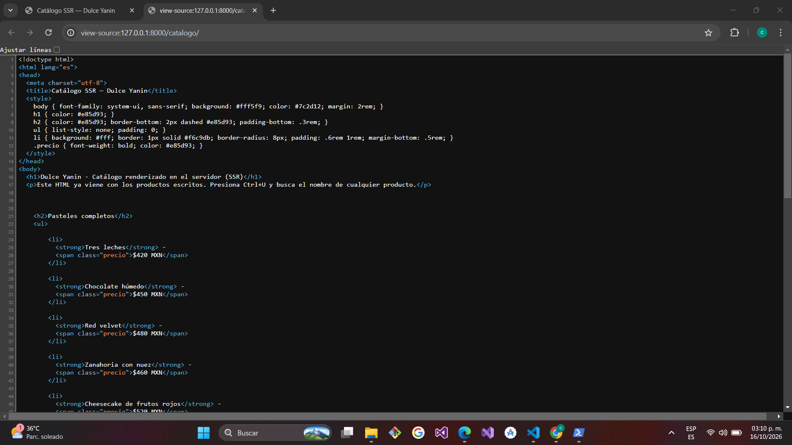
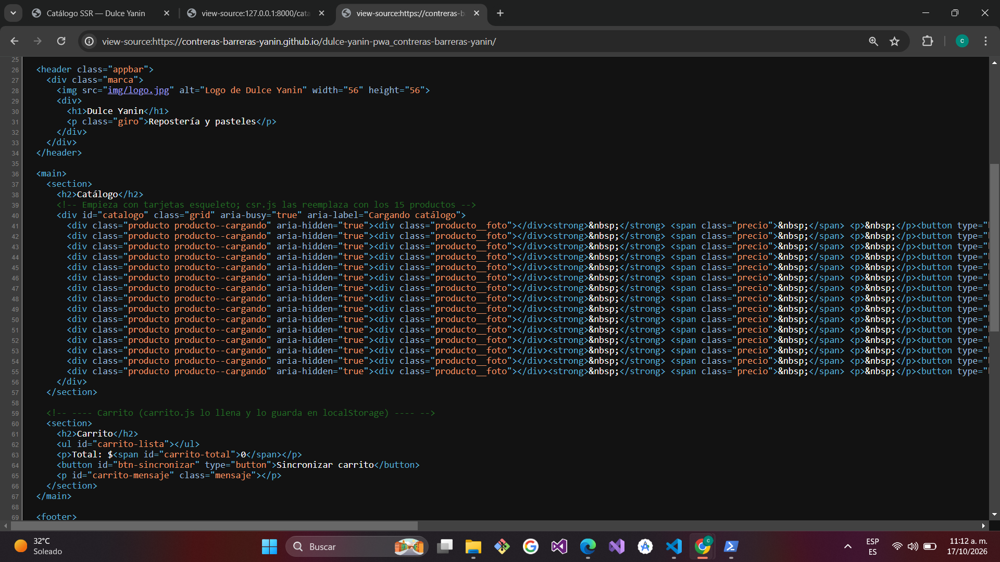

# Dulce Yanin — PWA de ventas

| Dato | Valor |
|---|---|
| **Alumno** | CONTRERAS BARRERAS YANIN |
| **Grupo** | ING10-1 |
| **Negocio · giro** | Dulce Yanin · Repostería y pasteles |
| **URL del repositorio** | https://github.com/Contreras-Barreras-Yanin/dulce-yanin-pwa_contreras-barreras-yanin |
| **URL de GitHub Pages** | https://contreras-barreras-yanin.github.io/dulce-yanin-pwa_contreras-barreras-yanin/ |

## Historial de avances

| Avance | Hash del commit entregado | Fecha |
|---|---|---|
| 1 | 906088a03ccb1043274d0733292c393a7d825c0b | 11/10/2026 |
| 2 | (se anota en el avance 3) | 18/10/2026 |
| 3 | (hash del avance 3) | 25/10/2026 |
| 4 | (se escribe en el reporte PDF) | 01/11/2026 |

## Comparación SSR vs CSR

### SSR (Django): los productos llegan escritos en el HTML

### CSR (JavaScript): el div del catálogo llega vacío

## Cómo correr servidor-ssr (Django)

Desde la raíz del repositorio, en PowerShell:

    cd servidor-ssr
    python -m venv venv
    venv\Scripts\activate
    pip install -r requirements.txt
    python manage.py runserver

Luego abre http://127.0.0.1:8000/catalogo/ y presiona Ctrl+U: los 15 productos de Dulce Yanin aparecen escritos en el HTML (SSR).