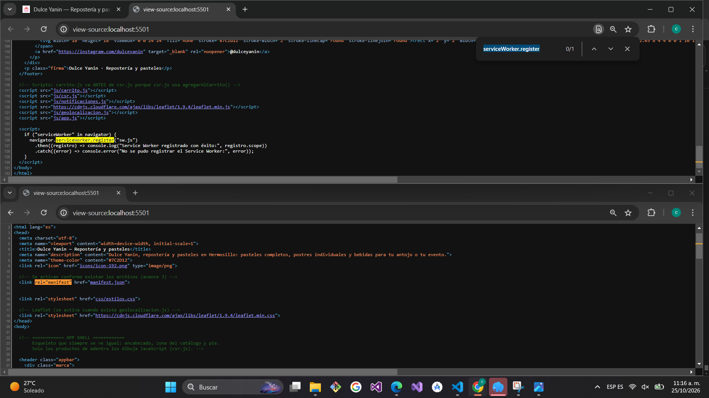
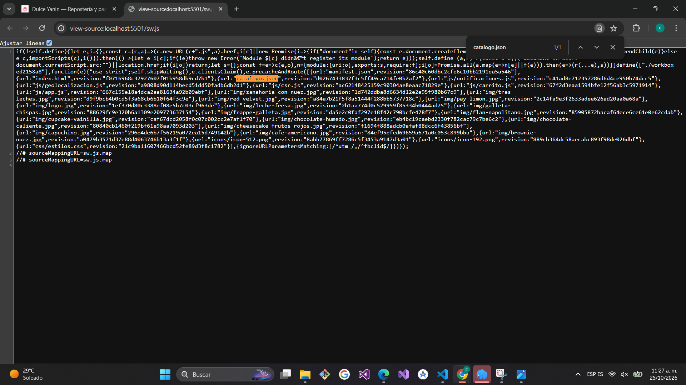
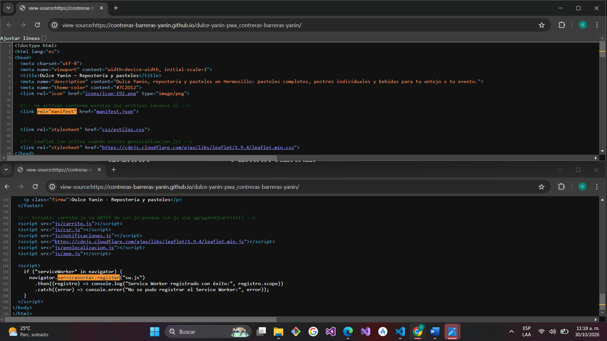
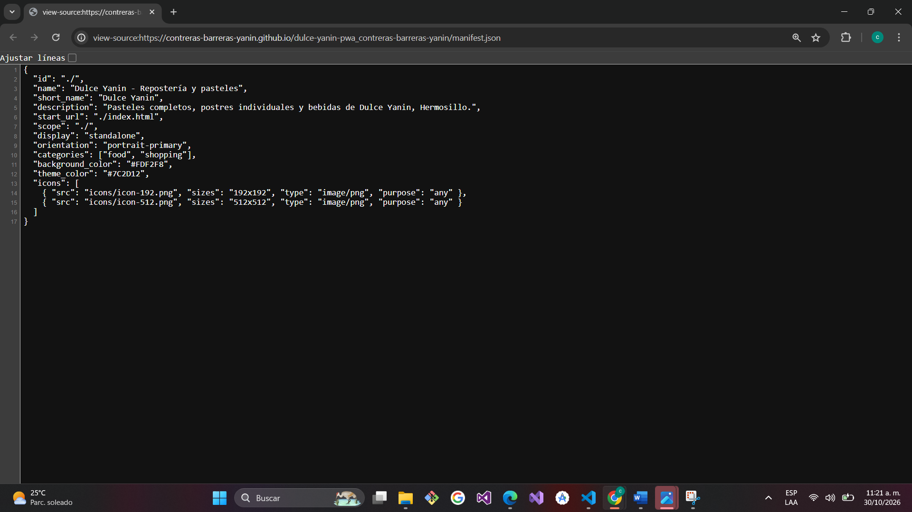
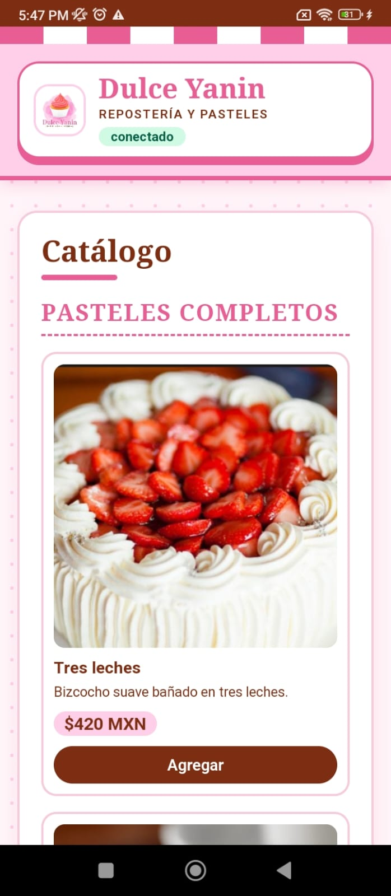

# Dulce Yanin — PWA de ventas

| Dato | Valor |
|---|---|
| **Alumno** | CONTRERAS BARRERAS YANIN |
| **Grupo** | ING10-1 |
| **Negocio · giro** | Dulce Yanin · Repostería y pasteles |
| **URL del repositorio** | https://github.com/Contreras-Barreras-Yanin/dulce-yanin-pwa_contreras-barreras-yanin |
| **URL de GitHub Pages** | https://contreras-barreras-yanin.github.io/dulce-yanin-pwa_contreras-barreras-yanin/ |

## Historial de avances

| Avance | Hash del commit entregado | Fecha |
|---|---|---|
| 1 | 906088a03ccb1043274d0733292c393a7d825c0b | 11/10/2026 |
| 2 | 148d8d7b43d6e413e9ec3d56913f4dc5f4bae57f | 18/10/2026 |
| 3 | d65e4c3ed0998b3b11930c876a875bef9b0f835f | 25/10/2026 |
| 4 | (se escribe en el reporte PDF) | 01/11/2026 |

## Comparación SSR vs CSR

### SSR (Django): los productos llegan escritos en el HTML

### CSR (JavaScript): el div del catálogo llega vacío

## Funciones PWA (avance 3)

### index.html: manifest y registro del Service Worker activos

### sw.js: Workbox precachea el catálogo y las fotos

## Versión publicada (avance 4)

### index.html en GitHub Pages

### manifest.json en GitHub Pages

### Mi app instalada en el celular

## Guía de instalación y uso

### 1. Cómo abrir la app
1. Abre Chrome (o Edge) en tu celular o en tu computadora, con internet.
2. Escribe esta dirección y presiona Enter: https://contreras-barreras-yanin.github.io/dulce-yanin-pwa_contreras-barreras-yanin/
3. Espera a que cargue el catálogo de Dulce Yanin con sus 15 productos.

### 2. Cómo instalarla
**En Android (Chrome):**
1. Abre la dirección de la app en Chrome.
2. Toca el menú de tres puntos (⋮), arriba a la derecha.
3. Elige "Instalar app" (o "Agregar a la pantalla principal").
4. Toca "Instalar". El ícono de Dulce Yanin aparece en tu pantalla de inicio.

**En iPhone (Safari):**
1. Abre la dirección de la app en Safari.
2. Toca el botón Compartir.
3. Elige "Agregar a pantalla de inicio" y toca "Agregar".

**En computadora (Chrome o Edge):**
1. Abre la dirección de la app.
2. Haz clic en el ícono de instalar que aparece a la derecha de la barra de direcciones.
3. Haz clic en "Instalar".

Después de instalarla, ábrela desde su ícono: se ve a pantalla completa, sin la barra de direcciones del navegador.

### 3. Cómo usarla
- **Catálogo:** hay 15 productos en tres categorías (Pasteles completos, Postres individuales y Bebidas), cada uno con foto, descripción y precio.
- **Carrito:** toca "Agregar" en un producto. En la sección Carrito puedes subir o bajar la cantidad con + y −, quitar un producto con "Quitar" y ver el total. El carrito se guarda en tu navegador y sigue ahí aunque cierres la app.
- **Notificaciones:** toca "Activar notificaciones" y acepta el permiso. Al agregar un producto te aparece el aviso "Pedido agregado".
- **Cómo llegar:** en "Cómo llegar" toca "Ver ruta a la sucursal" y acepta el permiso de ubicación. Se muestra el mapa con la distancia y el tiempo hasta Dulce Yanin, en Av. Sonora y Calle Jesús García, Centro, Hermosillo.
- **Sin internet:** el catálogo y las fotos siguen disponibles. La etiqueta de arriba cambia a "sin conexión" y, cuando regresa el internet, el carrito se sincroniza y te avisa.

## Cómo correr servidor-ssr (Django)

Desde la raíz del repositorio, en PowerShell:

    cd servidor-ssr
    python -m venv venv
    venv\Scripts\activate
    pip install -r requirements.txt
    python manage.py runserver

Luego abre http://127.0.0.1:8000/catalogo/ y presiona Ctrl+U: los 15 productos de Dulce Yanin aparecen escritos en el HTML (SSR).